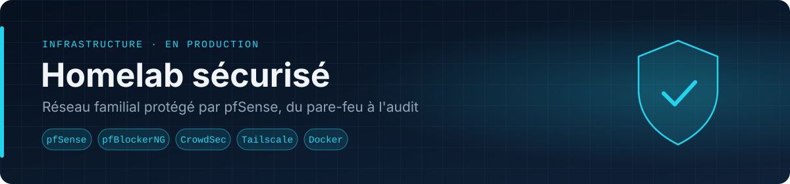
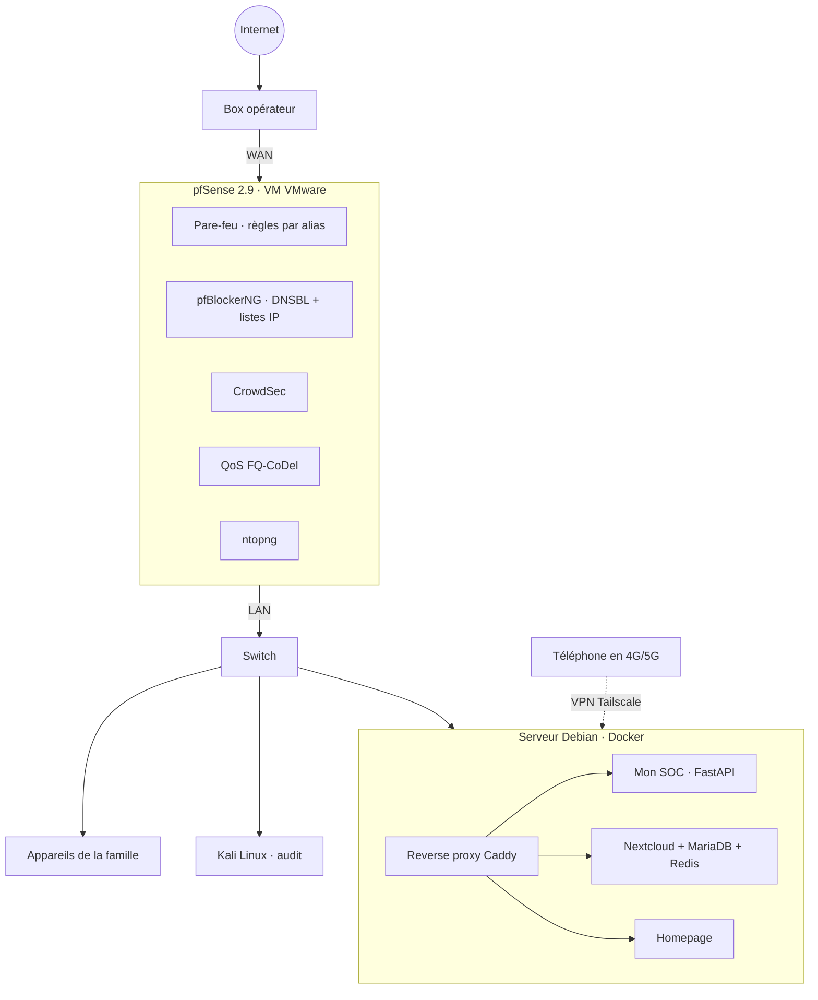

> Un vrai réseau, utilisé tous les jours par ma famille, que je conçois, sécurise, supervise et audite moi-même.

## 🎯 Objectifs

- Protéger **tous les appareils de la maison** (PC, téléphones) derrière un pare-feu que je maîtrise
- Bloquer pubs, trackers et sites malveillants **au niveau du réseau**, sans rien installer sur les appareils
- Garder un **ping stable** pour le jeu en ligne et la visio
- Accéder à mes services **depuis l'extérieur sans ouvrir de port** sur Internet
- **Auditer** mon propre réseau comme le ferait un attaquant, puis corriger

## 🗺️ Architecture

## 🧱 Ce que j'ai mis en place

| Domaine | Réalisation | Détails |
|---|---|---|
| Pare-feu | pfSense 2.9 virtualisé (VMware Workstation, cartes vmxnet3) | [docs/01-pfsense.md](docs/01-pfsense.md) |
| Filtrage | pfBlockerNG (listes IP + DNSBL HaGeZi, blocage DoH/DoT) et CrowdSec | [docs/02-filtrage.md](docs/02-filtrage.md) |
| Performance | QoS FQ-CoDel : bufferbloat noté **A+** | [docs/03-qos.md](docs/03-qos.md) |
| Accès distant | VPN Tailscale (subnet router + exit node), filtrage DNS conservé à l'extérieur | [docs/04-vpn.md](docs/04-vpn.md) |
| Services | Nextcloud, Homepage, reverse proxy Caddy, noms de domaine locaux | [docs/05-services.md](docs/05-services.md) |
| Supervision | ntopng + mon tableau de bord maison [**mon-soc**](https://github.com/sujeenthiran/mon-soc) | |
| Audit | Scan Kali/Nmap puis durcissement (5 → 2 ports exposés) | [docs/06-audit-kali.md](docs/06-audit-kali.md) |

## 📊 Résultats

| Indicateur | Résultat |
|---|---|
| Ports ouverts côté Internet sur pfSense | **0** (aucune règle WAN) |
| Ports exposés sur le serveur après audit | **5 → 2** (SSH par clé + reverse proxy) |
| Bufferbloat | **A+** |
| Débit LAN derrière la VM | ~340 Mbit/s, volontairement limité pour garder un ping stable |

## 🧠 Ce que j'ai appris

- **Une mise à jour peut tout casser** : une montée de version ratée a vidé ma configuration. Depuis, je fais un snapshot de la VM et j'exporte le XML de pfSense avant chaque changement.
- **L'ordre des règles compte** : une règle « bloquer les réseaux privés » placée trop haut bloquait l'accès à ntopng et à pfBlockerNG.
- **Le contournement DNS est courant** : DNS sécurisé du navigateur, VPN intégré… d'où le blocage DoH/DoT et des DNS extérieurs.
- **Le matériel fixe les limites** : la carte USB et la virtualisation plafonnent le débit, il faut choisir entre débit maximum et latence stable.
- **Auditer soi-même** fait ressortir des choses invisibles au quotidien, comme des ports Docker ouverts sur tout le réseau.

## 🔜 Prochaines étapes

- Sauvegarde automatique de Nextcloud sur disque externe
- Supervision de disponibilité (Uptime Kuma)
- SIEM Wazuh sur une VM dédiée
- Mini-PC à 2 ports Intel pour un pfSense physique

---
⚠️ *Les adresses IP, noms d'hôtes, clés et mots de passe réels ont été retirés ou remplacés par des exemples.*
